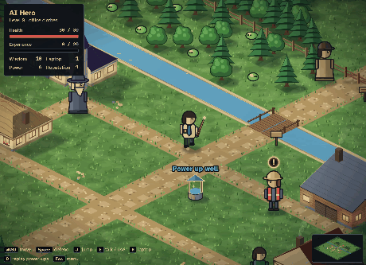
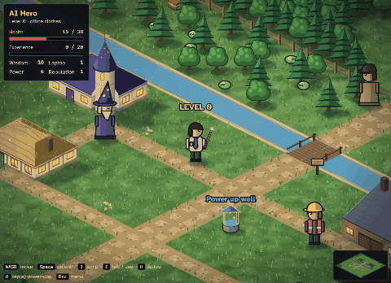

# Voice Over: a companion RPG for *Beyond the Buzz*

**Voice Over** is a small 2.5D browser RPG made as a companion to the Microsoft Azure digital event **[Beyond the Buzz: Building an Agent from Scratch](https://info.microsoft.com/ww-landing-beyond-the-buzz-building-an-agent-from-scratch.html)**. You play the **AI Hero**, an office worker who arrives in a village with a wand, meets the villagers who keep an agent project on track, powers up at a magic well, and finally outgrows **Sir Agent "Blocker"**.

The whole game is a single HTML file. There's nothing to install and no build step, and every image in it is drawn in code.

> **Join the event:** [register for *Beyond the Buzz: Building an Agent from Scratch*](https://info.microsoft.com/ww-landing-beyond-the-buzz-building-an-agent-from-scratch.html)

---

## Play it

| Where | How |
|---|---|
| On your computer | Download [`index.html`](index.html) and open it in Chrome, Edge, Firefox or Safari. |
| In the browser | If GitHub Pages is turned on for this repo, open the repo's Pages address. |
| On a phone or tablet | Same file. On-screen buttons replace the keyboard. |

Progress saves in your own browser, so you can close the tab and continue later. Without internet the game still runs; only the fonts fall back to your computer's standard ones.

### Controls

| Key | Action |
|---|---|
| **WASD** or **arrow keys** | Walk |
| **Space** | Defend (wave your wand) |
| **J** | Jump (a high jump clears enemies) |
| **E** or **Enter** | Talk, open chests, pick things up |
| **H** | Use a laptop (restores health) |
| **O** | Replay the power-ups from level 0 |
| **Esc** | Menu |

---

## What happens in the game

You start at **level 0**, in a pressed shirt and tie.

### The villagers

Walk up to anyone with a gold **!** above their head and press **E**. Each villager says one line, and a **Quest completed!** message appears.

| Villager | What they say |
|---|---|
| **Memory Wizard** | "Commit and Sync!" |
| **Quartermaster** | "First thing first, let's get the necessary tools and verify their readiness!" |
| **Contractor** | "I am a magic AI builder, describe the agent you want me to build!" |
| **Chef** | "Remember, recipes, ingredients, and taste tests!" |
| **Inspector** | "Let me have visibility." |

### The Power up well

The glowing well in the village square upgrades you each time you use it. Every use adds a level, fills your experience bar, and puts on a new piece of gear:

1. **Visor**: a glowing blue band, +2 power
2. **Armour**: a steel chest plate and shoulder pads, +3 reputation
3. **Shield**: carried on the off arm, +2 reputation and +15 max health

Press **O** at any time to watch the hero drop back to level 0 and put all three on in quick succession.

### Sir Agent "Blocker"

A great wolf waits beyond the north gate. Fight it if you like, but once you reach **level 3** it takes one look at you and says *"Wow, you are now so powerful, I am Sir Agent "Blocker" no more."* Then it vanishes, and the game sends you off with *"Onto new adventure - see you again!"*

### Your stats

| Stat | What it means in play |
|---|---|
| **Wisdom** | Earned from chests, quests and defeated enemies |
| **Laptop** | Each one restores health (press **H**) |
| **Power** | How hard your wand hits |
| **Reputation** | How well you shrug off hits |

---

## How it's built

Everything lives in [`index.html`](index.html): about 1,700 lines of HTML, CSS and plain JavaScript, with no frameworks, no libraries and no image files.

| Part | How it works |
|---|---|
| **2.5D view** | An isometric projection on a 2D canvas. Tile `(x, y)` sits at screen `((x − y)·32, (x + y)·16)`, and height is subtracted from screen y. |
| **Depth** | Every tree, wall tile, character and object is sorted by `x + y` each frame and drawn back to front. |
| **World** | The village is hand-drawn as rows of characters (`T` tree, `~` water, `,` path, `#` house…) inside a larger, procedurally generated wilderness. |
| **Ground** | Grass, paths, riverbanks and the bridge are painted once into cached 8×8-tile sections at screen resolution, so the detailed terrain costs almost nothing per frame. |
| **Light** | One sun at the upper left. Shapes are lit on that side and shaded on the other. All cast shadows are merged into one soft layer, so overlaps never double-darken. |
| **Buildings** | Each house has its own roof form: hipped, single-slope, thatched, or a gable facing the street. Roofs are sloped surfaces sampled at tile corners, and each slope is shaded by how directly it faces the sun. The Memory Wizard's round tower is drawn as a cylinder with a cone. |
| **Characters** | Built from simple shapes with a dark ink outline, so silhouettes read on any background. People are drawn larger than life against the buildings, for readability. |
| **Game feel** | Camera shake that builds and decays, a brief freeze on hits, squash and stretch on jumps and hits, sparks, dust, a light column and rings on power-ups. All of it switches off under the system's *reduce motion* setting. |
| **Quests & saving** | A small state machine per quest, with progress saved in `localStorage`. |
| **Readability** | Interface text uses [Atkinson Hyperlegible](https://fonts.google.com/specimen/Atkinson+Hyperlegible), a typeface designed for legibility, with high-contrast panels. |

---

## How it was built

Voice Over was built iteratively, in conversation with an AI coding agent: describe a change, play the result, then describe the next change. Roughly in order:

1. **A text RPG.** It started as a menu-driven battle game, which was rejected as too simple.
2. **A walkable 2.5D world.** An isometric village you walk around with the keyboard, with villagers to talk to, objects to use, quests and real-time combat.
3. **A bigger world.** The map grew into open wilderness around the village. People were drawn larger, and the hero changed into office clothes.
4. **The event theme.** The villagers became the Memory Wizard, Chef, Contractor, Inspector and Quartermaster, each with one line. The well became the **Power up well**, the boss became **Sir Agent "Blocker"**, and the game was renamed **Voice Over**.
5. **Feel and feedback.** Jumping, power-up effects, levels tied to power-ups, the boss giving up at level 3, and the farewell message.
6. **A graphics pass guided by game-dev agent skills** (see below): consistent sun lighting, soft merged shadows, textured terrain, ink outlines, and impact effects.
7. **Unique buildings and polish.** A shape of its own for every building, a wand instead of a stick, renamed stats, and the **O** power-up replay.

Every step was published and play-tested before the next one.

---

## Inspiration

- **[awesome-gamedev-agent-skills](https://github.com/gamedev-skills/awesome-gamedev-agent-skills)**: a curated set of skills that teach AI agents game-development practice. Two of them shaped the graphics pass:
  - **[create-game-assets](https://github.com/gamedev-skills/awesome-gamedev-agent-skills/blob/main/skills/disciplines/create-game-assets/SKILL.md)** for art direction: one light direction, shared palette roles, consistent edges, and silhouettes that read at game scale.
  - **[game-feel](https://github.com/gamedev-skills/awesome-gamedev-agent-skills/blob/main/skills/disciplines/game-feel/SKILL.md)** for impact effects: trauma-based screen shake, hit-stop, squash and stretch, and feedback scaled to how important an event is.
- Classic isometric adventure games, for the tile-based 2.5D look.

---

## Repo contents

| Path | What it is |
|---|---|
| [`index.html`](index.html) | The entire game |
| [`media/`](media) | The GIFs in this README, cut from gameplay recordings |
| [`LICENSE`](LICENSE) | MIT License |

## License

Released under the [MIT License](LICENSE). You're free to use, change and share it.

---

**Building agents for real?** [Register for *Beyond the Buzz: Building an Agent from Scratch*](https://info.microsoft.com/ww-landing-beyond-the-buzz-building-an-agent-from-scratch.html).
